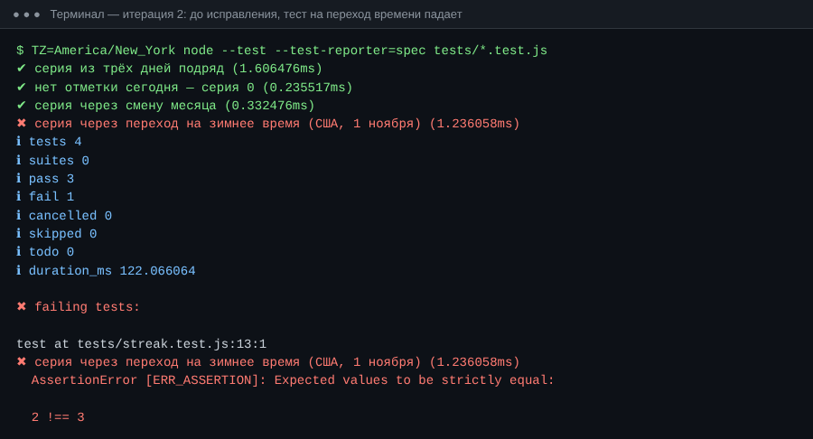
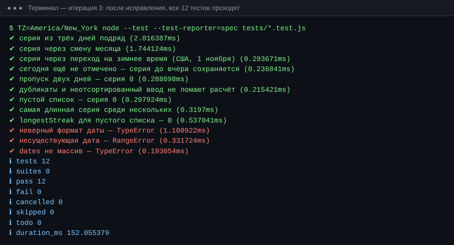
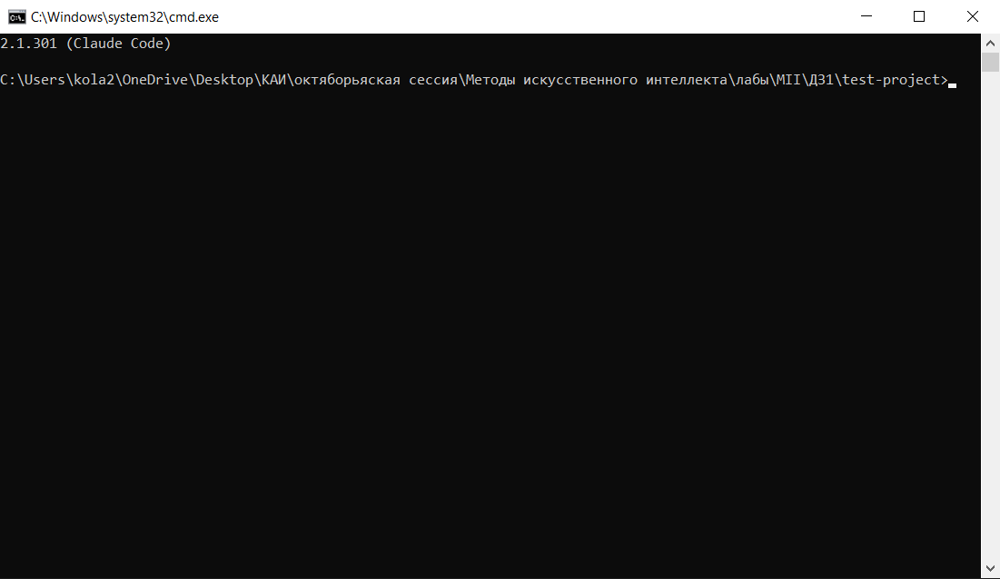
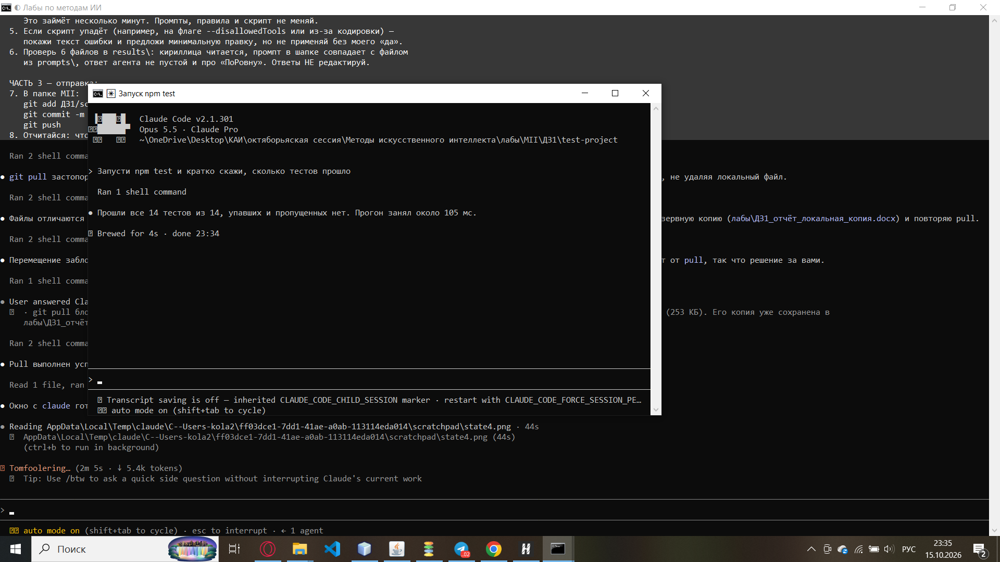

# ДЗ1. Сравнительный анализ и настройка AI-инструментов

**Дисциплина:** Методы искусственного интеллекта
**Выполнил:** Творогов Д.Н., гр. 4481

Состав папки:

| Файл | Что содержит |
|---|---|
| `report.md` | этот отчёт (шаги 1–6) |
| `comparison_table.md` | сравнительная таблица с оценками и обоснованием |
| `prompts_log.md` | журнал работы с агентом: промпты, итерации, сложности |
| `test-project/` | тестовый проект, созданный с помощью Claude Code |
| `screenshots/` | скриншоты работы |

---

## 1. Описание задачи и требований (Шаг 1)

### Задача
Веб-приложение **«Трекер привычек»**. Пользователь регистрируется, заводит привычки (например, «читать 20 минут», «зарядка») и каждый день отмечает их выполнение. Приложение показывает текущую и рекордную серию дней подряд и статистику за неделю и месяц.

Проект сквозной: в ДЗ2–ДЗ5 для него будут созданы правила для агента, ТЗ и макеты, фронтенд, затем бэкенд.

**Предполагаемый стек:** React + Vite + Tailwind CSS (фронтенд), Supabase — PostgreSQL, Auth, REST API (бэкенд), GitHub для хранения кода.

### Ключевые требования

| Требование | Описание | Что это значит для выбора инструмента |
|---|---|---|
| **Сложность** | Средняя: 4–5 экранов, авторизация, CRUD привычек и отметок, расчёт серий и статистики, тесты. Проект будет развиваться через 5 домашних заданий. | Нужен агент, который держит контекст всего проекта и умеет вести многошаговые задачи, а не только генерирует один экран. |
| **Доступ к локальным файлам** | Обязателен. Код хранится в моём Git-репозитории, нужно запускать тесты, npm, git, позже Docker и миграции БД. | Агент должен работать с локальной папкой и выполнять команды в терминале. |
| **Безопасность данных** | Код учебный и публичный, его передача в облачную модель допустима. Но в приложении будут персональные данные (email, история привычек), которые по 152-ФЗ нельзя бездумно передавать третьим лицам. Ключи API (Supabase) не должны попадать в промпты и репозиторий. | При разработке используются только mock-данные. Агент должен уважать `.gitignore`/`.env` и спрашивать разрешение на действия. |
| **Бюджет** | Студенческий: не больше ~$20 (≈2000 ₽) в месяц. Уже оплачена подписка Claude Pro. Оплата зарубежных сервисов из РФ затруднена. | Предпочтительны бесплатные тарифы или уже оплаченные подписки. |

---

## 2. Анализ инструментов (Шаг 2)

Сравнивалось 6 инструментов: 3 облачных агента (Bolt.new, Lovable, Replit Agent) и 3 IDE/CLI-агента (Cursor, GitHub Copilot, Claude Code). Оценка по 6 критериям задания, шкала 1–5, с весами по требованиям из раздела 1.

**Разница между типами агентов:**
- **Cloud-агенты** работают целиком в браузере: среда разработки, выполнение кода и хостинг находятся на стороне сервиса. Они быстро дают рабочий прототип без установки, но код и данные живут на чужих серверах, а интеграция с собственным репозиторием ограничена.
- **IDE-агенты** встроены в редактор кода (Cursor — отдельная IDE, Copilot — плагин). Они работают с локальными файлами и помогают по ходу написания кода.
- **CLI-агенты** (Claude Code) запускаются в терминале в папке проекта и сами выполняют задачу целиком: читают файлы, пишут код, запускают команды и тесты.

### Итоговая таблица (подробные обоснования — в `comparison_table.md`)

| Инструмент | Тип | Контекст ×3 | Скорость ×1 | Качество ×3 | Стоимость ×1 | Безопасность ×2 | Интеграция ×2 | **Итог /60** |
|---|---|:-:|:-:|:-:|:-:|:-:|:-:|:-:|
| Bolt.new | Cloud | 3 | 5 | 3 | 3 | 2 | 2 | 34 |
| Lovable | Cloud | 3 | 5 | 3 | 2 | 2 | 3 | 35 |
| Replit Agent | Cloud | 3 | 4 | 3 | 3 | 2 | 2 | 33 |
| Cursor | IDE | 5 | 4 | 4 | 3 | 4 | 5 | 52 |
| GitHub Copilot | IDE | 4 | 5 | 4 | 5 | 4 | 5 | 52 |
| **Claude Code** | **CLI** | **5** | **4** | **5** | **4** | **4** | **4** | **54** |

---

## 3. Обоснование выбора (Шаг 3)

### Выбран: Claude Code

**Ключевые факторы:**
1. **Полный доступ к проекту и терминалу.** Требование «доступ к локальным файлам» для меня главное. Claude Code работает прямо в папке репозитория и сам запускает `npm test`, `git` и прочие команды. В тестовой задаче (раздел 5) агент сам прочитал вывод упавшего теста и исправил код.
2. **Качество на многошаговых задачах.** Проект будет расти 5 заданий подряд. Агенту нужно держать контекст и доводить задачу до проходящих тестов, а не просто подсказывать строку кода.
3. **Нулевые дополнительные затраты.** Claude Code входит в подписку Claude Pro, которая у меня уже есть.
4. **Файл правил `CLAUDE.md`.** Постоянные инструкции проекта автоматически подгружаются в каждую сессию. Это напрямую понадобится в ДЗ2 (создание системы правил).
5. **Контроль действий.** Агент запрашивает разрешение на изменение файлов и выполнение команд, поэтому я вижу и подтверждаю всё, что он делает.

### Почему не подошли альтернативы

| Альтернатива | Почему не выбрана |
|---|---|
| **Cursor** (52) | Близкий по возможностям вариант и лучшая IDE-интеграция. Но это ещё $20/мес поверх уже оплаченной подписки, а кредиты на топовые модели быстро заканчиваются. Оплата из РФ затруднена. |
| **GitHub Copilot** (52) | Самый выгодный по цене (бесплатно для студентов), отличное автодополнение. Но в агентном режиме хуже самостоятельно ведёт многошаговые задачи, а для меня это важнее скорости автодополнения. Хороший **запасной вариант**, если закончатся лимиты Claude Pro. |
| **Lovable** (35) | Быстро делает красивый UI и умеет работать с Supabase, но кредитов бесплатного тарифа (около 30 в месяц) не хватит на проект из 5 заданий. Код живёт в облаке сервиса. Можно использовать точечно для генерации UI-концепций в ДЗ3. |
| **Bolt.new** (34) | Отличен для быстрого прототипа, но работает в своей облачной среде, а не в моём репозитории. Токены быстро тратятся на исправления. |
| **Replit Agent** (33) | Удобен «всё в одном» (код + хостинг), но привязывает к своей облачной IDE. Агент расходует кредиты в зависимости от сложности задачи, поэтому бюджет трудно предсказать. |

**Российские решения.** Рассматривался и GigaCode (Сбер): плагин для VS Code и JetBrains, данные обрабатываются в РФ, что упрощает соответствие 152-ФЗ. Для коммерческого проекта с реальными персональными данными в периметре компании это был бы весомый аргумент. Мой проект учебный, код публичный, а при разработке используются только mock-данные. Поэтому решающими стали возможности агента, а не локализация данных.

---

## 4. Описание процесса настройки (Шаг 4)

### 4.1. Установка Claude Code

Нативный установщик (рекомендуемый способ):

```bash
# macOS / Linux / WSL
curl -fsSL https://claude.ai/install.sh | bash

# Windows (PowerShell)
irm https://claude.ai/install.ps1 | iex
```

Альтернатива через npm (нужен Node.js 18+):
```bash
npm install -g @anthropic-ai/claude-code
```

Проверка установки:
```bash
claude --version
```

### 4.2. Авторизация
1. Запуск в папке проекта: `cd habit-tracker-test && claude`
2. При первом запуске (или командой `/login`) выбран вход через аккаунт Claude. Использую подписку **Claude Pro**, поэтому отдельный API-ключ не нужен.

### 4.3. Настройка проекта
- **`CLAUDE.md`.** Команда `/init` анализирует проект и создаёт файл с описанием стека, командами и правилами. Мой итоговый файл — `test-project/CLAUDE.md`.
- **Разрешения.** По умолчанию агент спрашивает подтверждение перед изменением файлов и запуском команд. Для безопасной работы оставил этот режим и разрешаю действия вручную.
- **`.gitignore`.** В тестовый проект добавлен `.gitignore` с `node_modules/` и `.env`, чтобы секреты не попали в репозиторий.
- **Интеграция с IDE (по желанию).** Расширение Claude Code для VS Code показывает изменения агента в виде diff прямо в редакторе.

### 4.4. MCP (Model Context Protocol)
MCP позволяет подключать к агенту внешние инструменты и источники данных (GitHub, базы данных, документация) командой:
```bash
claude mcp add <имя> -- <команда запуска сервера>
claude mcp list   # список подключённых серверов
```
**На этапе ДЗ1 MCP не требуется.** Агенту достаточно локальных файлов и терминала, а GitHub доступен через обычный `git`. MCP планирую подключить в ДЗ5 для работы с базой данных Supabase.

### 4.5. Тестовый проект
Создан `test-project/` — минимальный Node.js-проект без внешних зависимостей:

```
test-project/
├── CLAUDE.md            — правила проекта для агента
├── package.json         — скрипт npm test
├── .gitignore
├── src/streak.js        — функции currentStreak и longestStreak
└── tests/streak.test.js — 12 тестов на node:test
```

Запуск: `cd test-project && npm test`

---

## 5. Примеры работы с инструментом (Шаг 5)

Задача: **сгенерировать по описанию функцию расчёта серии выполнения привычки** — ядро будущего трекера — и покрыть её тестами. Полный журнал с текстами промптов — в `prompts_log.md`.

| Итерация | Промпт (кратко) | Результат |
|---|---|---|
| 1 | Создать `currentStreak(dates, today)` и 3 теста | Функция создана. Скрипт тестов упал (`node --test tests/` в Node 22 не принимает папку). Агент сам исправил скрипт, 3/3 теста прошли. |
| 2 | Тест на переход на зимнее время + прогон в 4 часовых поясах | **Найден баг:** в `America/New_York` серия 2 вместо 3 из-за `setDate()` в местном времени. |
| 3 | Исправить на UTC-арифметику, добавить `longestStreak`, валидацию, тесты на ошибки | Модуль переписан, **12/12 тестов** проходят в 5 часовых поясах. |
| 4 | Создать `CLAUDE.md` с выработанными правилами | Правила зафиксированы для следующих сессий. |

**Всего:** 4 итерации, 2 найденные и исправленные проблемы.

### Скриншоты

**До исправления** — тест на переход времени падает (ожидалось 3, получено 2):



**После исправления** — все 12 тестов проходят:



**Установленный Claude Code на моём компьютере:**





---

## 6. Выводы и рекомендации

### Выводы
1. **Cloud-агенты и IDE/CLI-агенты решают разные задачи.** Облачные (Bolt.new, Lovable, Replit) лучше всего подходят для быстрого прототипа или демо за час без установки. Для проекта, который развивается в своём репозитории, с тестами и контролем над кодом, они проигрывают по контексту, безопасности и интеграции.
2. **Для моего проекта оптимален Claude Code** (54/60): полный доступ к проекту и терминалу, высокое качество на многошаговых задачах и отсутствие дополнительных затрат при имеющейся подписке.
3. **Агент не заменяет проверку.** В тестовой задаче первая версия кода выглядела правильной и проходила простые тесты. Баг с часовыми поясами нашёлся только после явной просьбы проверить граничные случаи.

### Рекомендации
- Сразу формулировать в промпте граничные случаи и требовать запуска тестов. Агент сам доведёт код до рабочего состояния.
- Выработанные договорённости записывать в `CLAUDE.md`, а не повторять в каждом промпте.
- Не передавать агенту реальные персональные данные и секреты: при разработке использовать mock-данные, а ключи хранить в `.env` под `.gitignore`.
- Держать запасной инструмент (GitHub Copilot, бесплатный для студентов) на случай исчерпания лимитов подписки.

### Чек-лист выбора AI-инструмента (по итогам работы)
- [ ] Нужен ли доступ к локальному репозиторию и терминалу? → да: IDE/CLI-агент; нет: можно Cloud.
- [ ] Есть ли в проекте персональные или коммерческие данные? → да: локальный инструмент, mock-данные, при необходимости российское или on-premise решение.
- [ ] Какой бюджет и есть ли уже оплаченные подписки или студенческие программы?
- [ ] Насколько сложен и долог проект? → долгий и многошаговый: агент с постоянным контекстом (файл правил).
- [ ] Умеет ли агент сам запускать тесты и исправлять ошибки?
- [ ] Можно ли контролировать действия агента (подтверждения, ограничения)?

---

*Источники цен (октябрь 2026): официальный блог GitHub о тарифах Copilot (май 2026), обзоры тарифов Bolt.new, Lovable, Replit и Cursor за 2026 г. (jetadmin.io, eesel.ai, softr.io).*
