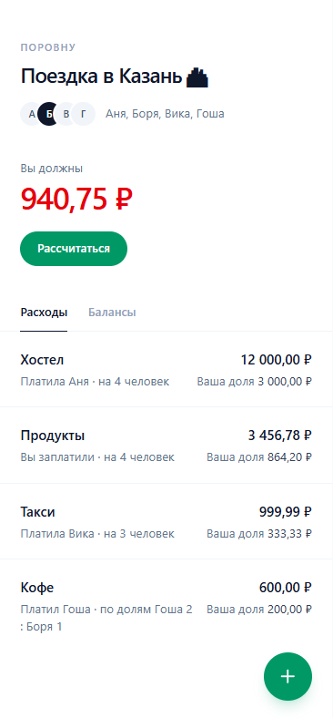
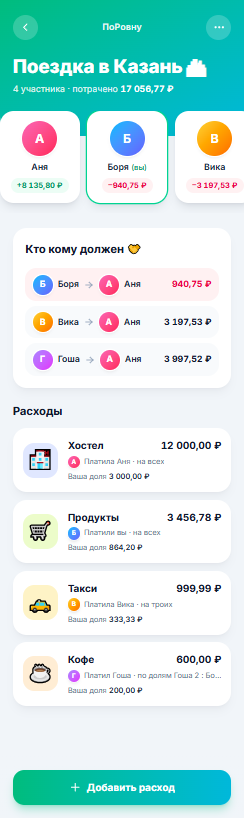
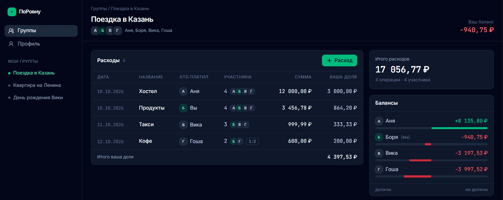

# ДЗ3. UI-концепции «ПоРовну» (Шаг 2)

**Выполнил:** Творогов Д.Н., гр. 4481
**Инструмент:** v0.dev (Text-to-UI от Vercel). Генерирует интерфейс на React + Tailwind по текстовому описанию, что совпадает со стеком проекта.

## Что генерировалось

Для сравнения выбран **ключевой экран — «Группа»**: на нём пользователь проводит больше всего времени. Экран содержит:
- шапку группы («Поездка в Казань», 4 участника);
- блок «Кто кому должен»;
- ленту расходов;
- кнопку добавления расхода.

Для всех трёх концепций используются одни и те же данные, отличаются только стиль и компоновка:

| | Данные |
|---|---|
| Группа | «Поездка в Казань 🏙», участники Аня, Боря, Вика, Гоша |
| Расходы | Хостел 12 000 ₽ (платила Аня, на всех); Продукты 3 456,78 ₽ (Боря, на всех); Такси 999,99 ₽ (Вика, на троих без Ани); Кофе 600 ₽ (Гоша, по долям Гоша 2 : Боря 1) |
| Текущий пользователь | Боря |
| Балансы (посчитаны модулем `settle.js` из ДЗ1) | Аня +8 135,80 ₽; Боря −940,75 ₽; Вика −3 197,53 ₽; Гоша −3 997,52 ₽ (сумма 0) |
| Кто кому должен | Гоша → Аня 3 997,52 ₽; Вика → Аня 3 197,53 ₽; Боря → Аня 940,75 ₽ |

## Промпты для v0.dev

### Концепция 1 — «Минимализм»

```text
Создай мобильный экран (ширина 390px) веб-приложения «ПоРовну» для дележа общих расходов в компании.
Экран группы «Поездка в Казань 🏙», 4 участника: Аня, Боря, Вика, Гоша. Текущий пользователь — Боря.
Стиль: минималистичный, светлый фон, много воздуха, монохромная палитра slate и один акцентный цвет emerald,
тонкие линии-разделители вместо карточек, системный шрифт. React + Tailwind. Весь текст на русском.
Компоновка: сверху название группы и аватары участников; под ним крупно баланс пользователя
«Вы должны 940,75 ₽» (красным) с кнопкой «Рассчитаться»; ниже переключатель вкладок «Расходы | Балансы».
Вкладка «Расходы» — простой список: Хостел 12 000,00 ₽ (платила Аня, на 4 человек), Продукты 3 456,78 ₽ (Боря),
Такси 999,99 ₽ (Вика, на 3 человек), Кофе 600,00 ₽ (Гоша, по долям Гоша 2 : Боря 1). У каждой строки — «Ваша доля».
Плавающая круглая кнопка «+» внизу справа для добавления расхода.
```

### Концепция 2 — «Яркая»

```text
Создай мобильный экран (ширина 390px) веб-приложения «ПоРовну» для дележа общих расходов в компании.
Экран группы «Поездка в Казань 🏙», 4 участника: Аня, Боря, Вика, Гоша. Текущий пользователь — Боря.
Стиль: яркий и дружелюбный, градиентная шапка (от emerald к cyan), крупные эмодзи-иконки категорий,
скруглённые карточки с тенью, весёлые цветные аватары. React + Tailwind. Весь текст на русском.
Компоновка: шапка с названием группы; под ней горизонтальная карусель карточек участников — у каждого аватар,
имя и баланс («+8 135,80 ₽» зелёным, «−940,75 ₽» красным); затем блок «Кто кому должен» со стрелками
«Гоша → Аня 3 997,52 ₽», «Вика → Аня 3 197,53 ₽», «Боря → Аня 940,75 ₽»; ниже лента расходов карточками с эмодзи категорий: 🏨 Хостел 12 000,00 ₽ (Аня),
🛒 Продукты 3 456,78 ₽ (Боря), 🚕 Такси 999,99 ₽ (Вика, на троих), ☕ Кофе 600,00 ₽ (Гоша, по долям Гоша 2 : Боря 1).
Внизу — широкая кнопка «Добавить расход».
```

### Концепция 3 — «Корпоративная / дашборд»

```text
Создай адаптивный экран (десктоп 1280px, на мобильном колонки складываются в одну) веб-приложения «ПоРовну»
для дележа общих расходов. Экран группы «Поездка в Казань», 4 участника: Аня, Боря, Вика, Гоша.
Стиль: строгий деловой дашборд, тёмная тема (slate-900), акцент emerald, моноширинные цифры сумм,
плотная информация как в банковском приложении. React + Tailwind. Весь текст на русском.
Компоновка: слева боковое меню (Группы, Профиль); в центре таблица расходов с колонками
Дата | Название | Кто платил | Участники | Сумма | Ваша доля (Хостел 12 000,00 ₽ — Аня — 4; Продукты 3 456,78 ₽ — Боря — 4;
Такси 999,99 ₽ — Вика — 3; Кофе 600,00 ₽ — Гоша — 2, доли Гоша 2 : Боря 1) и кнопка «+ Расход» над таблицей;
справа панель: «Итого расходов 17 056,77 ₽», балансы участников с горизонтальными полосками
(зелёные — им должны, красные — они должны) и список «Кто кому должен» с кнопками «Отметить перевод».
```

## Результаты генерации

Все три концепции сгенерированы в одном чате v0.dev: https://v0.app/mii21/chat/rQt5QVBRYNs. Каждая концепция — отдельный запрос с промптом из раздела выше. На третьем запросе закончились бесплатные кредиты (сообщение «Out of Credit»), но превью уже было готово. Скриншоты обрезаны до области превью.

### Концепция 1 — «Минимализм»



**Ключевые особенности:**
- светлый фон, палитра slate, единственный акцент — emerald (кнопки «Рассчитаться» и «+»);
- главное число экрана — крупное «Вы должны 940,75 ₽» красным, сразу под ним действие «Рассчитаться»;
- вкладки «Расходы | Балансы», список расходов без карточек, только тонкие разделители;
- в каждой строке есть «Ваша доля», для расхода по долям видна подпись «по долям Гоша 2 : Боря 1»;
- плавающая кнопка «+» для нового расхода.

**Плюсы:** отвечает на главный вопрос пользователя («сколько я должен?») за секунду; минимум элементов, поэтому проще всего реализовать и покрыть тестами; хорошо читается на маленьком экране; легко расширить тёмной темой.

**Минусы:** «Кто кому должен» и балансы спрятаны во второй вкладке; мало визуальной индивидуальности; на десктопе остаётся узкая колонка с пустыми полями.

### Концепция 2 — «Яркая»



**Ключевые особенности:**
- градиентная шапка emerald → cyan, в ней сразу итог «потрачено 17 056,77 ₽»;
- горизонтальная карусель участников с цветными аватарами и балансами, карточка текущего пользователя выделена рамкой;
- блок «Кто кому должен 🧡» со стрелками, строка текущего пользователя подсвечена;
- лента расходов карточками с иконками категорий; широкая кнопка «Добавить расход» внизу.

**Плюсы:** весь ответ на экране «Группа» сразу, без вкладок; дружелюбный стиль подходит молодой аудитории (друзья, соседи, студенты); свой долг легко найти за счёт подсветки.

**Минусы:** перегружено — длинный скролл, мелкий текст в карточках; четвёртый участник (Гоша) в карусели уходит за край экрана; подписи обрезаются («по долям Гоша 2 : Бо…»); градиенты и тени дороже в поддержке и хуже по контрасту.

### Концепция 3 — «Корпоративная / дашборд»



**Ключевые особенности:**
- тёмная тема slate-900, моноширинные цифры, плотная таблица «как в банке»;
- слева меню (Группы, Профиль) и список «Мои группы» — переключение между группами в один клик;
- таблица расходов с колонками Дата | Название | Кто платил | Участники | Сумма | Ваша доля, итог «Итого ваша доля 4 397,53 ₽»;
- справа панель: «Итого расходов 17 056,77 ₽», балансы с полосками (зелёные — им должны, красные — должны они), ниже «Кто кому должен» с кнопками «Отметить перевод».

**Плюсы:** максимум информации на одном экране; удобно сверять суммы (моноширинный шрифт, выравнивание по правому краю); хорошая основа для десктопной версии.

**Минусы:** рассчитан на десктоп — таблица на 6 колонок не помещается в телефон; блок «Кто кому должен» уходит под сгиб экрана; деловой тёмный стиль тяжеловат для бытовой задачи «скинуться за пиццу».

## Сравнение

| Критерий | 1. Минимализм | 2. Яркая | 3. Дашборд |
|---|---|---|---|
| Ответ «сколько я должен» виден сразу | ✅ крупно вверху | ✅ подсветка в списке | ✅ в шапке справа |
| «Кто кому должен» без лишних действий | ❌ во вкладке | ✅ | ⚠️ ниже сгиба |
| Удобство на телефоне (основной сценарий) | ✅ | ⚠️ перегружено | ❌ |
| Удобство на десктопе | ⚠️ узкая колонка | ⚠️ узкая колонка | ✅ |
| Читаемость и контраст | ✅ | ⚠️ мелкий текст | ✅ |
| Сложность реализации | низкая | средняя | средняя |

## Выбор и обоснование

**Выбрана концепция 1 «Минимализм» как основа, с двумя заимствованиями.**

Почему именно она:
1. **Аудитория пользуется телефоном.** Расход добавляют сразу после оплаты — в кафе, такси, магазине (см. `project_description.md`). Мобильный экран важнее десктопного, а концепция 3 на телефоне не работает.
2. **Главное действие на первом экране.** Пользователь открывает группу, чтобы узнать свой долг и закрыть его, — в концепции 1 это крупная сумма и кнопка «Рассчитаться» без скролла.
3. **Простота реализации и тестов.** Минимум декоративных элементов — меньше кода и проще проверять экраны через React Testing Library (ДЗ4).
4. **Контраст и читаемость** лучше, чем у яркой концепции с мелким текстом на градиентах.

Что берём из других концепций:
- **из концепции 2** — блок «Кто кому должен» со стрелками и подсветкой строки текущего пользователя: он становится содержимым вкладки «Балансы» вместе с балансами участников;
- **из концепции 3** — десктопная раскладка от 1024 px: слева список групп, справа панель с итогом, балансами-полосками и кнопками «Отметить перевод»; моноширинные цифры для сумм во всех размерах.

Итоговый экран «Группа»: на телефоне — концепция 1 (шапка с долгом → вкладки «Расходы | Балансы» → кнопка «+»); на десктопе — три колонки как в концепции 3, но в светлой теме концепции 1. Именно эта концепция используется в `user_stories.md` и `technical_specification.md`.
