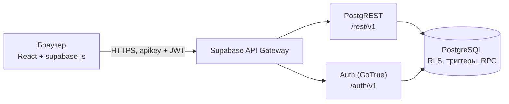

# ДЗ5. Документация бэкенда «ПоРовну»

**Выполнил:** Творогов Д.Н., гр. 4481

## 1. Архитектура



- **Своего сервера нет.** Фронтенд обращается к Supabase напрямую через `supabase-js`. Для таблиц PostgREST автоматически даёт REST-API, для функций — RPC (`/rest/v1/rpc/<имя>`).
- **Все права проверяет база.** Ключ `anon` (publishable) публичный и виден в браузере. Защищают данные политики RLS, права на таблицы и колонки, триггеры и функции `security definer`.
- **Бизнес-правила на сервере:** проверка участников и долей расхода, расчёт балансов (тот же алгоритм наибольших остатков, что во фронтенде), выход из группы только при нулевом балансе, лимит 50 участников.

| Слой | Файлы |
|---|---|
| Схема и права | `poravnu/supabase/migrations/2026101600000{1..5}_*.sql`, проектирование — `db_design.md` |
| Клиент API | `poravnu/src/api/supabaseApi.ts` (запросы), `database.types.ts` (типы таблиц), `supabaseErrors.ts` (коды ошибок → тексты ТЗ) |
| Вход | `poravnu/src/app/AuthProvider.tsx`, `RequireAuth.tsx`, `src/pages/AuthPage.tsx`, `JoinPage.tsx` |
| Журнал | `poravnu/src/lib/logger.ts`: JSON-строки `{level, event, op, status, code, …}` без токенов и паролей |
| Тесты | `poravnu/supabase/tests/db.test.ts` (36 тестов БД на PGlite), `poravnu/scripts/e2e-supabase.mjs` (34 проверки живого API) |

## 2. Развёртывание

### Новый проект Supabase

1. Создать проект на supabase.com (регион — Европа). Пароль базы сохранить у себя: приложению он не нужен.
2. **Authentication → Sign In / Providers → Email:** выключить «Confirm email». Для учебного MVP вход сразу после регистрации; в production — включить и настроить SMTP.
3. **SQL Editor → New query:** вставить `poravnu/supabase/deploy.sql` целиком и выполнить один раз. Ожидаемо: «Success. No rows returned». Предупреждение о «destructive operations» вызывают строки `revoke` и `drop policy if exists` — это нормально.
4. **Project Settings → API Keys:** скопировать Project URL и publishable-ключ в `poravnu/.env.local` (образец — `.env.example`).
5. Проверить: `npm run test:e2e` — должно быть 34 / 34.

### Обновление существующей базы

Выполняется только **новая** миграция (например, `20261016000005_review_fixes.sql`), а не весь `deploy.sql`: повторный запуск упадёт на `relation already exists`. С Supabase CLI то же самое делает команда `supabase db push`.

### Переменные окружения

| Переменная | Где | Секрет? |
|---|---|:-:|
| `VITE_SUPABASE_URL` | `.env.local`, позже — настройки Vercel (ДЗ6) | нет |
| `VITE_SUPABASE_ANON_KEY` | то же; publishable-ключ | нет — публичный по замыслу |
| `service_role` / secret-ключ, пароль БД | **нигде в проекте**: только в панели Supabase | **да** |

## 3. API

Все запросы содержат заголовок `apikey: <publishable>`. После входа к нему добавляется `Authorization: Bearer <access_token>`; supabase-js делает это сам. Базовый адрес — `https://<ref>.supabase.co`.

### 3.1. Авторизация

| Операция | HTTP | supabase-js |
|---|---|---|
| Регистрация | `POST /auth/v1/signup` `{email, password, data:{name}}` | `auth.signUp({email, password, options:{data:{name}}})` |
| Вход | `POST /auth/v1/token?grant_type=password` | `auth.signInWithPassword({email, password})` |
| Обновление токена | `POST /auth/v1/token?grant_type=refresh_token` | автоматически |
| Выход | `POST /auth/v1/logout` | `auth.signOut()` |

Профиль (`profiles`) создаётся триггером `on_auth_user_created`, имя берётся из `data.name`.

```bash
curl -X POST "$URL/auth/v1/token?grant_type=password" \
  -H "apikey: $ANON" -H "Content-Type: application/json" \
  -d '{"email":"borya.poravnu.demo@example.com","password":"Demo-pass-2026"}'
# → {"access_token":"eyJ…","refresh_token":"…","user":{…}}
```

### 3.2. Таблицы (REST)

| Ресурс | Чтение | Создание | Изменение | Удаление |
|---|---|---|---|---|
| `profiles` | `id, name, created_at` — свой и тех, с кем есть общая группа | триггер | только своё `name` | — |
| `groups` | участники группы | RPC `create_group` | — | — |
| `members` | участники группы | RPC `create_group`, `join_group` | — | RPC `leave_group` (мягко: `left_at`) |
| `expenses` | участники группы | участник; `created_by` = он сам | автор: `title, amount_kop, payer_id, split, date, category` | автор |
| `transfers` | участники группы | отправитель или получатель | — | автор, если оба участника ещё в группе |

```bash
# Лента расходов группы
curl "$URL/rest/v1/expenses?group_id=eq.$GROUP&order=date.desc" -H "apikey: $ANON" -H "Authorization: Bearer $TOKEN"

# Новый расход «Такси» 1 500 ₽, поровну на троих
curl -X POST "$URL/rest/v1/expenses" -H "apikey: $ANON" -H "Authorization: Bearer $TOKEN" \
  -H "Content-Type: application/json" -H "Prefer: return=representation" \
  -d '{"group_id":"…","title":"Такси","amount_kop":150000,"payer_id":"…","date":"2026-10-16",
       "split":{"memberIds":["…","…","…"]}}'
```

Деление по долям: `"split":{"weights":{"<user_id>":2,"<user_id>":1}}` — целые от 1 до 1000.

```ts
// То же через supabase-js (src/api/supabaseApi.ts)
const { data, error } = await client.from('expenses').insert({ group_id, title, amount_kop, payer_id, split, date }).select().single();
```

### 3.3. Функции (RPC)

| Функция | Параметры | Возвращает | Кто может |
|---|---|---|---|
| `create_group` | `p_name`, `p_emoji` | строка `groups` | вошедший |
| `get_invite_preview` | `p_token` | `group_name, emoji, members_count` | **гость тоже** — для экрана приглашения |
| `join_group` | `p_token` | `uuid` группы | вошедший |
| `leave_group` | `p_group` | — | участник с нулевым балансом |
| `rotate_invite` | `p_group` | новый токен | владелец |
| `my_groups` | — | `id, name, emoji, active_members_count, my_balance_kop, last_activity_at` | вошедший |
| `group_balances` | `p_group` | `member_id, balance_kop` | участник |

```bash
curl -X POST "$URL/rest/v1/rpc/leave_group" -H "apikey: $ANON" -H "Authorization: Bearer $TOKEN" \
  -H "Content-Type: application/json" -d '{"p_group":"…"}'
# при долге → 409 {"code":"PT409","message":"balance_not_zero","details":"-94075","hint":"Сначала рассчитайтесь"}
```

Служебные функции (`is_active_member`, `expense_shares` и др.) лежат в схеме `private`, которая через API не публикуется. Запрос к ним даёт 404 `PGRST202`.

### 3.4. Ошибки

| HTTP | `code` | `message` | Когда | Текст в интерфейсе |
|:-:|---|---|---|---|
| 400 | `23514` | `empty_split`, `invalid_weight`, `invalid_split`, `inactive_member`, `duplicate_member`, `invalid_date`, `immutable_field`, имя CHECK | неверные данные | из `hint` |
| 401 | `PT401` / `42501` без JWT | `not_authenticated`, `permission denied` | не выполнен вход, токен истёк | переход на экран входа |
| 403 | `PT403` / `42501` | `forbidden`, нарушение RLS | нет прав в группе | «Нет доступа» |
| 404 | `PT404` | `invalid_invite` | неверная ссылка (ERR-8) | «Ссылка недействительна» |
| 404 | `PGRST116` | — | группы нет или она чужая (ERR-7) | «Группа недоступна» |
| 409 | `PT409` | `balance_not_zero`, `group_full` | выход с долгом, 50 участников | из `hint` |
| 5xx / сеть | — | — | сбой Supabase или связи (ERR-3, ERR-5) | «Нет связи… Повторить» |

Перевод кодов в тексты делает `src/api/supabaseErrors.ts` (17 тестов). Каждая ошибка пишется в журнал событием `api.request_failed`.

### 3.5. CORS

Supabase отвечает на preflight `Access-Control-Allow-Origin: *`. Ограничить домены для REST-API на бесплатном тарифе нельзя, и это не нужно: без JWT запрос не получит чужих данных. Для Auth в **Authentication → URL Configuration** задаются Site URL и Redirect URLs. В ДЗ6 туда добавится адрес на Vercel (нужно для OAuth).

## 4. Безопасность

| Угроза | Защита | Проверено |
|---|---|---|
| Гость читает данные | у `anon` нет прав ни на одну таблицу | e2e №21 (401) |
| Посторонний читает или пишет в группу | RLS + проверка участия в триггерах | тесты БД, e2e №19–20 |
| Подмена автора, даты создания, группы | права на колонки, `created_by` = `auth.uid()`, триггер `immutable_field` | тесты БД, e2e |
| Сбор email участников | SELECT `profiles` только по `id, name, created_at` | e2e «Email… не читается» |
| Подмена `search_path` в `security definer` | `set search_path = ''` у всех функций | AI-ревью |
| Гонки при выходе | advisory-блокировка группы | ручной сценарий |
| Подбор пароля к БД | длинный случайный пароль; приложению прямое подключение не нужно | логи Postgres, `logs_analysis.md` |
| Утечка ключей | в git только `.env.example`; `service_role` не используется | `git grep` |

**Security Advisor**: до миграции 5 было 12 предупреждений, после — 9. Три касались служебных функций (`is_active_member`, `shares_group`, `expense_has_left_member`) и убраны переносом в `private`. Оставшиеся «Signed-in users can execute SECURITY DEFINER» относятся к RPC, которые и должны вызываться клиентом. Каждая такая функция сама проверяет `auth.uid()` и участие. «Leaked Password Protection» доступна только на платном тарифе.

## 5. Как работал AI-агент

| Шаг | Что делал агент | Результат |
|---|---|---|
| Проектирование | RTCF-промпт → схема, 4 миграции, ER-диаграмма | `db_design.md` |
| Проверка | тесты БД на PGlite нашли 2 ошибки в сгенерированном SQL | исправлены до деплоя |
| Интеграция | замена mock-API на supabase-js при том же контракте `DataApi` | 190 → 202 теста без правки экранов |
| Независимое ревью | второй агент на ПК, только чтение | 16 находок, `ai_db_review.md` |
| Исправления | миграция 5 + 12 тестов | `ai_db_review_response.md` |
| Логи | разбор API- и Postgres-логов | `logs_analysis.md` |
| Диагностика | 10 типовых проблем с командами и промптами | `backend_diagnostics.md` |
