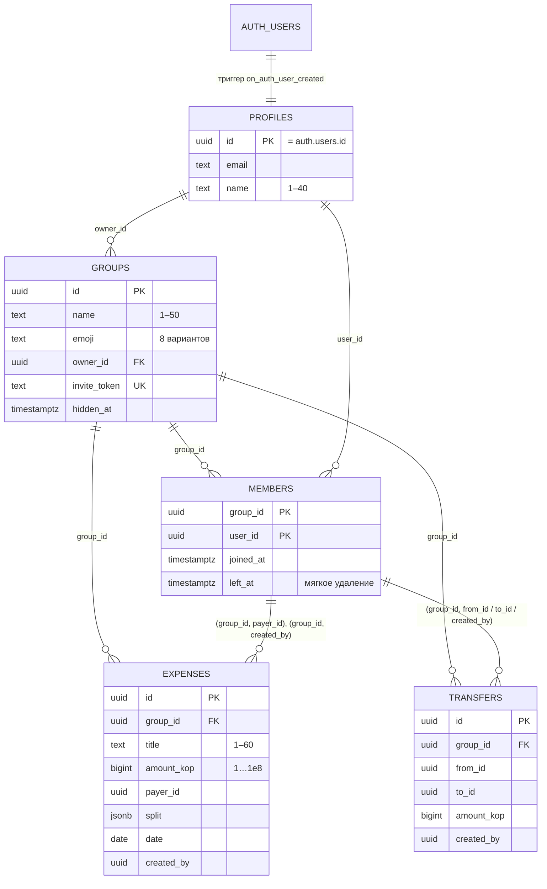

# ДЗ5. Проектирование базы данных с AI-агентом (Шаг 1)

**Выполнил:** Творогов Д.Н., гр. 4481

## 1. Требования к данным

Источник — ТЗ из ДЗ3 (`ДЗ3/technical_specification.md`, раздел 3 «Модель данных», раздел 3.1 «Доступ»). Ниже — что из ТЗ определяет схему:

| Требование | Что из него следует для БД |
|---|---|
| Деньги — только целые копейки (NFR-5), расход до 1 000 000 ₽ | `bigint`, `CHECK (amount_kop between 1 and 100000000)` |
| Остаток копеек раздаётся по порядку вступления (Q1) | у участия есть `joined_at`; порядок `(joined_at, user_id)` |
| Деление поровну или по долям 1–1000 (FR-3.4) | `split jsonb` + проверка в триггере |
| Вышедший участник остаётся в истории (FR-2.4) | мягкое удаление `members.left_at` |
| Данные группы видят только её участники (NFR-4) | RLS на всех таблицах |
| Вступление по ссылке, лимит 50 (FR-2.3, Q9) | `groups.invite_token`, RPC `join_group` |
| Выход только с нулевым балансом (AC-11.2) | баланс считается на сервере, RPC `leave_group` |

## 2. Запрос к AI-агенту

Схема сгенерирована Claude Code по RTCF-промпту (шаблон из ДЗ2):

```text
Role: ты — архитектор баз данных PostgreSQL с опытом в Supabase (Auth, PostgREST, RLS).
Task: спроектируй схему БД для MVP «ПоРовну» по ТЗ (ДЗ3/technical_specification.md, разделы 3 и 3.1):
таблицы, связи, поля и типы, ограничения, индексы; политики RLS для ролей anon и authenticated;
серверные функции (RPC) для операций, которые меняют несколько таблиц или требуют обхода RLS;
триггер создания профиля при регистрации. Разбей результат на миграции.
Context: деньги — bigint в копейках; деление расхода — алгоритм наибольших остатков с порядком
вступления (как splitByWeights во фронтенде, ДЗ4); вышедшие участники остаются в истории;
фронтенд обращается к БД напрямую через supabase-js, поэтому права проверяет только база.
Format: ER-диаграмма (mermaid), 4 SQL-миграции (схема, функции и триггеры, RPC, RLS и права),
таблица «требование ТЗ → объект БД», список решений с обоснованием.
```

## 3. Результат: схема



Миграции лежат в `poravnu/supabase/migrations/`:

| Файл | Содержание |
|---|---|
| `…0001_schema.sql` | 5 таблиц, составные внешние ключи, CHECK-ограничения, 3 индекса под ленту и «Мои группы» |
| `…0002_functions.sql` | профиль при регистрации; `is_active_member`, `shares_group`; `split_weights`, `expense_shares`, `group_balances` — расчёт в SQL; триггеры проверки расхода и перевода |
| `…0003_rpc.sql` | `create_group`, `get_invite_preview`, `join_group`, `leave_group`, `rotate_invite`, `my_groups` |
| `…0004_rls.sql` | RLS на всех таблицах, 12 политик, точечные права на таблицы, колонки и функции |

## 4. Решения и их обоснование

| Решение | Почему |
|---|---|
| **Составные внешние ключи** `(group_id, payer_id) → members` | Плательщик и автор не могут оказаться «не из этой группы» даже при ошибке в клиенте. В ТЗ было просто `payer_id` |
| **`split` остался `jsonb`**, а не отдельная таблица долей | Расход создаётся одним REST-запросом без транзакции на клиенте. Цена — нет внешних ключей на участников, поэтому их проверяет триггер `validate_expense` |
| **Расчёт долей и балансов продублирован в SQL** | Выход из группы разрешён только при нулевом балансе — это должна проверять база, а не клиент. Совпадение SQL и TypeScript проверяет тест на 60 случайных расходах |
| **Операции над несколькими таблицами — RPC с `security definer`** | Создание группы — это группа плюс участие; вступление по ссылке — гостю нужно увидеть группу, к которой у него ещё нет доступа. Обычные права RLS такое не пропустят |
| **Права выданы точечно, `revoke` всего лишнего** | По умолчанию Supabase даёт `anon` и `authenticated` все права на новые таблицы и функции. Гость не видит ни одной таблицы; менять в расходе можно только 6 колонок |
| **Коды ошибок `PT401/403/404/409`** | PostgREST превращает их в HTTP-статусы. Клиент получает правильный 401/403/404/409, а в `hint` — текст для пользователя |
| **`search_path = ''` у всех функций** | Защита функций `security definer` от подмены объектов через `search_path` — рекомендация Supabase |
| **Вышедший участник теряет доступ к группе** | В ТЗ 3.1 было «вышедшие видят группу для истории». Но это противоречило поведению «группа пропадает из списка» (AC-11.1) и открывало данные тому, кто ушёл. Вернуться можно по ссылке (Q5) |

## 5. Проверка и корректировка схемы

**Автотесты на настоящем PostgreSQL.** Миграции накатываются на PGlite — PostgreSQL 18, скомпилированный в WebAssembly, с заглушкой схемы `auth` и ролями Supabase (`supabase/tests/pgHarness.ts`). **24 теста** проверяют ограничения, политики RLS для гостя, участника и постороннего, триггеры, RPC и совпадение расчётов с фронтендом. Тесты сразу нашли две ошибки в сгенерированной схеме:

| № | Ошибка | Как найдена | Исправление |
|---|---|---|---|
| 1 | **Балансы не сходились на 1 копейку** (−319 754 вместо −319 753). `sum(bigint)` в PostgreSQL возвращает `numeric`, и деление `bigint / numeric` стало дробным, без округления вниз. Лишние копейки не раздавались | тест «балансы как в AC-07.1» и тест совпадения с TypeScript | сумма весов явно приводится к `bigint` |
| 2 | **Посторонний получал ошибку валидации вместо отказа в доступе** (`23514 inactive_member` вместо `42501`). BEFORE-триггер срабатывает раньше проверки `WITH CHECK` политики RLS | тест «чужой не может добавить расход» | триггер первым делом проверяет участие и отвечает `42501` |

**AI-ревью схемы.** Независимый агент на ПК проверил миграции в режиме только чтения — `ai_db_review.md`, разбор находок — `ai_db_review_response.md`.

**Проверка на живом Supabase.** 31 запрос к API: CRUD, RLS, RPC, ошибки, CORS — `api_tests/e2e_results.md`.
