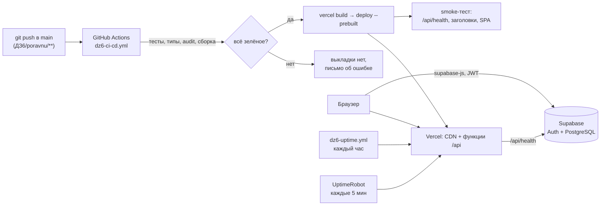

# ДЗ6. Выкладка и CI/CD

**Выполнил:** Творогов Д.Н., гр. 4481 · **Сайт:** https://poravnu.vercel.app

## 1. Архитектура

| Часть | Где работает | Что делает |
|---|---|---|
| Статика (`dist/`) | CDN Vercel | React-приложение; все адреса, кроме `/api/*` и `/assets/*`, отдают `index.html` (SPA) |
| `GET /api/health` | функция Vercel (Node.js) | проверяет Supabase Auth и БД, отвечает 200 или 503 — для мониторинга |
| `POST /api/log` | функция Vercel | принимает ошибки из браузера, чистит от персональных данных, пишет JSON в логи Vercel |
| Данные и вход | Supabase (из ДЗ5) | PostgreSQL с RLS, Auth: пароль и Google OAuth |

## 2. Конвейер (`.github/workflows/dz6-ci-cd.yml`)

Запускается на push в `main` и на pull request, если менялись `ДЗ6/poravnu/**` или сам workflow. Можно запустить и вручную (Actions → ДЗ6 CI/CD → Run workflow).

| Job | Шаг | Падает, если |
|---|---|---|
| **Тесты и сборка** | `npm ci` | lock-файл не совпадает с `package.json` |
| | `npm run typecheck` | ошибка типов TypeScript (strict), в том числе в `api/` |
| | `npm test` | любой из 230 тестов: фронтенд, функции `api/`, БД на PGlite |
| | `npm audit --omit=dev --audit-level=high` | в production-зависимостях есть уязвимость high/critical |
| | `npm run build` | сборка не прошла; размеры файлов попадают в отчёт запуска |
| **Выкладка на Vercel** (только `main`, после первого job) | `vercel link` → `pull` → `build --prod` → `deploy --prebuilt --prod` | нет `VERCEL_TOKEN`, ошибка сборки Vercel |
| | smoke-тест | `/api/health` не 200, `status` не `ok`, коммит в ответе не совпадает с выложенным, нет CSP или HSTS, SPA-маршрут не открывается |

Решения:
- **Сборка в GitHub Actions, а не Git-интеграцией Vercel.** Выкладка не начнётся, пока тесты не зелёные. Проект собирается из подпапки с кириллицей (`ДЗ6/poravnu`), что Git-интеграции неудобно. Копия проекта выкладывается вне git, а в `vercel.json` стоит `git.deploymentEnabled: false`, чтобы Vercel не собирал каждый push сам.
- **Smoke-тест проверяет версию.** `/api/health` возвращает короткий хеш коммита, и шаг сверяет его с `GITHUB_SHA`. Так видно, что отвечает именно новая выкладка, а не закэшированная старая.
- **Минимальные права.** `permissions: contents: read`; токен Vercel передаётся только в job выкладки; версия Vercel CLI закреплена (`vercel@61.1.0`).
- **Pull request** проходит только первый job. Выкладка предпросмотра не делается: у Vercel она закрыта авторизацией и для учебного проекта не нужна.

## 3. Секреты и переменные

| Имя | Тип в GitHub | Секрет? | Назначение |
|---|---|:-:|---|
| `VERCEL_TOKEN` | Secret | **да** | доступ CLI к аккаунту Vercel; срок — 90 дней |
| `VITE_SUPABASE_URL` | Variable | нет | адрес Supabase — попадает в бандл и в окружение функций |
| `VITE_SUPABASE_ANON_KEY` | Variable | нет | publishable-ключ; публичный по замыслу, защиту дают RLS |
| `VITE_YM_COUNTER_ID` | Variable | нет | номер счётчика Яндекс.Метрики |
| `PRODUCTION_URL` | Variable | нет | адрес для ежечасной проверки `dz6-uptime.yml` |

Ключ `service_role`, пароль базы и секрет Google OAuth не используются ни в коде, ни в CI. Секрет Google хранится только в панели Supabase.

Переменные окружения функций (`VITE_SUPABASE_*`, `APP_COMMIT`) задаются при выкладке флагами `vercel deploy -e`. В настройках проекта Vercel ничего вручную задавать не нужно.

## 4. Как выложить и откатить

| Действие | Как |
|---|---|
| Выложить изменение | push в `main` с изменениями в `ДЗ6/poravnu` — остальное сделает конвейер |
| Повторить выкладку без изменений | GitHub → Actions → **ДЗ6 CI/CD** → Run workflow |
| Откатить | Vercel → проект `poravnu` → Deployments → прошлая выкладка → **Promote to Production** (мгновенно, без пересборки); затем `git revert` проблемного коммита |
| Локально как в production | `npm run build && npm run preview` (без функций `/api`) |

## 5. Первая выкладка

Первый запуск с секретом прошёл все шаги без правок: проект `poravnu` на Vercel создала команда `vercel link`, сайт получил адрес https://poravnu.vercel.app. Скриншоты — в `screenshots/`.

| Проверка smoke-теста | Результат |
|---|---|
| `GET /api/health` | 200, `status: ok`, коммит совпал |
| `Content-Security-Policy`, `Strict-Transport-Security` | есть |
| `GET /groups/any-id` (SPA) | 200 |
