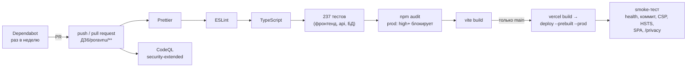
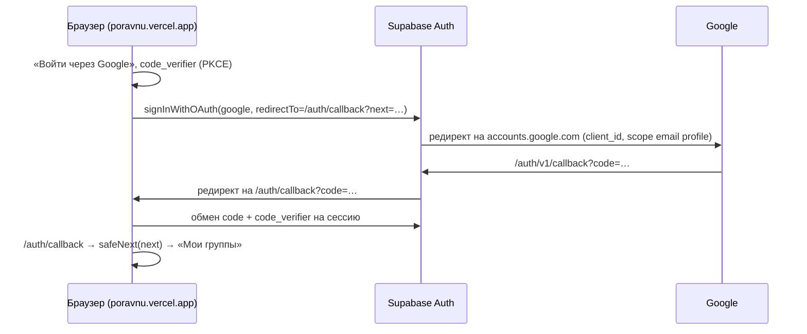

# ДЗ6. Настройка CI/CD и интеграция сервисов

**Выполнил:** Творогов Д.Н., гр. 4481 · **Проверил:** Тутубалин · **Сайт:** https://poravnu.vercel.app · **Репозиторий:** https://github.com/BALANAR073/MII

Документ сводит всё ДЗ6 в одном месте: конвейер CI/CD, инструкции по каждому подключённому сервису, итоги аудита безопасности, мониторинг и логирование, примеры конфигураций и проверку интеграций. Подробности вынесены в отдельные файлы:

| Файл | Что внутри |
|---|---|
| [`deployment.md`](deployment.md) | архитектура выкладки, секреты, откат |
| [`monitoring_logging.md`](monitoring_logging.md) | health check, мониторинг, формат логов, промпты для анализа логов |
| [`security_audit.md`](security_audit.md) | отчёт по аудиту безопасности |
| [`poravnu/`](poravnu/) | код приложения, `README.md` — запуск |
| [`screenshots/`](screenshots/) | скриншоты сервисов и проверок |

## 1. Что сделано — по шагам задания

| Шаг | Требование | Результат | Статус |
|---|---|---|:-:|
| 1 | CI/CD: зависимости, сборка, тесты, деплой, линтинг и форматирование, автодеплой из main | GitHub Actions `dz6-ci-cd.yml`: Prettier → ESLint → TypeScript → 237 тестов → `npm audit` → сборка → Vercel → smoke-тест | ✅ |
| 2 | Аудит безопасности: зависимости, OWASP Top 10, AI-анализ, исправления | 12 находок, 9 исправлено, 3 принятых риска; Dependabot, CodeQL, `npm audit` в каждом запуске | ✅ |
| 3 | OAuth2 | вход через Google (OAuth 2.0 + PKCE через Supabase Auth), приложение опубликовано | ✅ |
| 4 | Аналитика | Яндекс.Метрика, счётчик 113655788, 7 целей воронки | ✅ |
| 5 | Платежи (опционально) | не делались: в «ПоРовну» деньги переводят между собой участники, оплаты сервису нет | — |
| 6 | Мониторинг, health check, алерты | `GET /api/health` (Auth + БД), UptimeRobot раз в 5 минут, GitHub Actions раз в час, письма при сбое | ✅ |
| 7 | Логирование: JSON, уровни, централизованное хранение, AI-анализ | JSON-логи сервера и браузера в Vercel Runtime Logs, уровни info/warn/error, промпты и разобранные случаи | ✅ |
| 8 | Тестирование интеграций и оптимизация | проверка каждой интеграции (раздел 8), бандл стартовой страницы 464 → 24 КБ | ✅ |
| 9 | Документация, README | этот файл, `security_audit.md`, обновлён `poravnu/README.md` | ✅ |

Обязательный минимум — две интеграции из списка. Подключены **OAuth2 и аналитика**.

## 2. CI/CD

### Конвейер



| Workflow | Когда | Что делает |
|---|---|---|
| `dz6-ci-cd.yml` | push в main и PR с изменениями в `ДЗ6/poravnu/**`; вручную | проверки качества и тесты, затем выкладка на Vercel и smoke-тест (выкладка — только из main) |
| `dz6-codeql.yml` | push, PR, раз в неделю | статический анализ TypeScript и самих workflow на уязвимости |
| `dz6-uptime.yml` | каждый час | `GET /api/health` выложенного сайта; упавший запуск — письмо владельцу |
| `dependabot.yml` | раз в неделю | PR с обновлениями npm-пакетов и GitHub Actions |

### Проверки качества кода

| Шаг | Команда | Падает, если |
|---|---|---|
| Форматирование | `npm run format:check` (Prettier) | файл не отформатирован; список файлов — аннотациями к запуску |
| Линтер | `npm run lint` (ESLint, `--max-warnings=0`) | нарушены правила проекта (раздел 7.3) |
| Типы | `npm run typecheck` | ошибка TypeScript strict |
| Тесты | `npm test` (Vitest) | любой из 237 тестов; упавшие — аннотациями с файлом и текстом ошибки |
| Аудит зависимостей | `npm audit --omit=dev --audit-level=high` | уязвимость high/critical в пакетах, которые попадают в сайт |
| Сборка | `npm run build` | сборка не прошла; размеры файлов — в отчёте запуска |

Итоги каждого запуска видны прямо на странице запуска в Actions, без открытия логов: число пройденных тестов, сводка `npm audit`, результаты CodeQL.

### Автоматический деплой

Push в `main` → все проверки зелёные → `vercel build` и `vercel deploy --prebuilt --prod` → smoke-тест на основном адресе. Если хоть одна проверка красная, выкладки нет. Выкладка идёт из GitHub Actions, а не Git-интеграцией Vercel, по двум причинам: так деплой гарантированно начинается только после тестов, а проект лежит в подпапке с кириллицей. Подробно, с секретами и откатом, — в [`deployment.md`](deployment.md).

### Проверка на тестовых коммитах

| Коммит / PR | Что проверялось | Итог |
|---|---|---|
| `353c004` (первая выкладка) | без секрета `VERCEL_TOKEN` | ❌ шаг «Проверка секрета» с понятным сообщением — как и задумано |
| `1c1b153` | полная выкладка | ✅ сайт обновился, smoke-тест сверил коммит |
| PR #1 (аудит) | тесты в PR, без выкладки | ✅ влит после зелёного CI |
| PR #4–#7 (Dependabot: React 19, TS 7, Tailwind 4) | ломающие обновления | ❌ CI не пропустил, PR закрыты |
| PR #10 (линтер) | Prettier и ESLint в CI | ❌ → ✅ сначала нашлись неотформатированные файлы, исправлено |
| `bf3e521` | smoke-тест | ❌ → ✅ разовый сбой; причина найдена и устранена (раздел 6.4) |

## 3. OAuth 2.0 — вход через Google

### Как устроено



- **Backend-часть flow выполняет Supabase Auth**: хранит Client Secret, меняет код Google на профиль, создаёт пользователя и выдаёт JWT. Собственный сервер для OAuth не нужен, секрет не попадает ни в браузер, ни в репозиторий.
- **PKCE**: одноразовый `code` бесполезен без `code_verifier`, который знает только браузер, начавший вход.
- **Кнопка появляется сама.** Фронтенд читает публичные настройки `GET /auth/v1/settings` и показывает только включённых провайдеров. Код: `src/api/supabaseApi.ts` (`oauthProviders`, `signInWithOAuth`), `src/pages/AuthCallbackPage.tsx`.
- Профиль в таблице `profiles` создаётся триггером из ДЗ5; имя берётся из метаданных Google (`name`), а если его нет — из начала email.

### Инструкция по подключению

**Google Cloud Console** (https://console.cloud.google.com):
1. Создать проект `poravnu`. Кнопки «Try for free» и «Start free» не нужны: они требуют карту, а для OAuth она не нужна.
2. **Google Auth Platform → Get started**: имя приложения «ПоРовну», email поддержки, Audience — **External**, контакты, согласие.
3. **Branding**: домашняя страница `https://poravnu.vercel.app`, политика `https://poravnu.vercel.app/privacy`, Authorized domains — `poravnu.vercel.app` и `itppbtrmsbpreraaecqe.supabase.co`.
4. **Clients → Create OAuth client → Web application**:
   - Authorized JavaScript origins: `https://poravnu.vercel.app`;
   - Authorized redirect URIs: `https://itppbtrmsbpreraaecqe.supabase.co/auth/v1/callback` — адрес Supabase, а не сайта.
5. Скопировать **Client ID** и **Client Secret** (секрет показывается один раз).
6. **Audience → Publish app**. В режиме Testing войти могут только тестовые пользователи. Для разрешений `email` и `profile` проверка Google не требуется.

**Supabase** (`Authentication`):
7. **Sign In / Providers → Google**: включить, вставить Client ID и Client Secret, Save.
8. **URL Configuration**: Site URL `https://poravnu.vercel.app`; Redirect URLs `https://poravnu.vercel.app/**` и `http://localhost:5173/**`.

**В коде и CI ничего настраивать не нужно**: после шага 7 кнопка «Войти через Google» появляется на `/login` автоматически.

### Сложности при настройке

| Что случилось | Причина | Решение |
|---|---|---|
| Кнопки «Войти через Google» не было | провайдер не был включён в Supabase | шаги 1–7 |
| Supabase: «Client IDs should not contain spaces» | пробел при копировании | очистить поле и вставить заново |
| «Publish app» неактивна | Google требует домашнюю страницу и политику конфиденциальности | сделана страница `/privacy` (раздел 3 `security_audit.md`, С-08) |

### Обработка ошибок

| Ситуация | Что видит пользователь |
|---|---|
| Пользователь отменил вход у Google (`error=access_denied`) | «Вход отменён или провайдер вернул ошибку. Попробуйте ещё раз» + ссылка ко входу |
| Обмен кода не удался | «Вход не завершён. Попробуйте ещё раз» |
| `next=https://evil.example` или `/\t/evil.example` | возврат на `/` вместо чужого сайта (`safeNext`) |
| Провайдер выключен или `/auth/v1/settings` недоступен | кнопки нет, вход по паролю работает |

Тесты: `src/pages/AuthOAuth.test.tsx`, `src/lib/safeNext.test.ts`.

## 4. Аналитика — Яндекс.Метрика

### Как устроено

- Счётчик **113655788** подключается в `src/main.tsx` только в выложенной версии (`import.meta.env.PROD`) и только если задана переменная `VITE_YM_COUNTER_ID`. Код: `src/lib/metrika.ts`.
- Скрипт `tag.js` грузится с `mc.yandex.ru`, без inline-кода: так он проходит CSP (`script-src` разрешает только `mc.yandex.ru` и `yastatic.net`).
- **Просмотры страниц в SPA**: адрес меняется без перезагрузки, поэтому `App.tsx` сам отправляет `hit` при каждой смене маршрута.
- **Приватность**: Вебвизор выключен (на экранах суммы долгов и имена). Query из адреса отрезается, токен приглашения `/join/<token>` заменяется на `/join/:token`. В цели передаётся только факт действия, без сумм, имён и id.

### Цели (воронка продукта)

| Цель | Идентификатор | Где срабатывает |
|---|---|---|
| Регистрация | `sign_up` | `AuthPage.tsx`, успешная регистрация |
| Вход | `login` | `AuthPage.tsx`, успешный вход по паролю |
| Вход через Google | `oauth_start` | `AuthPage.tsx`, нажатие кнопки Google |
| Создание группы | `group_created` | `CreateGroupDialog.tsx` |
| Вступление в группу | `group_joined` | `JoinPage.tsx` |
| Добавлен расход | `expense_added` | `useOptimisticExpenses.ts` |
| Отмечен перевод | `transfer_marked` | `TransferDialog.tsx` |

Набор целей предложил AI-агент по user stories из ДЗ3: каждая цель — шаг воронки «регистрация → группа → приглашение → расход → расчёт». По ним видно, на каком шаге теряются пользователи.

### Инструкция по подключению

1. https://metrika.yandex.ru → **Добавить счётчик**: имя «ПоРовну», адрес `poravnu.vercel.app`, часовой пояс Москва, **Вебвизор не включать**. Экран с кодом счётчика пропустить: код уже встроен.
2. **Цели → Добавить цель → «Целевое событие · ex JS-событие»** (так в новом интерфейсе называется «JavaScript-событие»), идентификаторы — из таблицы выше. Пока тип не выбран, кнопка «Добавить цель» неактивна.
3. GitHub → Settings → Secrets and variables → Actions → **Variables**: `VITE_YM_COUNTER_ID = 113655788`.
4. Перевыложить сайт: Actions → **ДЗ6 CI/CD** → Run workflow (или любой push в `ДЗ6/poravnu`).

### Проверка отправки данных

DevTools → Network на https://poravnu.vercel.app (скриншот `screenshots/services/02_metrika_hits_network.png`):

| Запрос | Статус | Что значит |
|---|:-:|---|
| `tag.js` | 200 | скрипт счётчика загружен, CSP его пропустила |
| `113655788?wmode=7&page-…` | 200 | визит отправлен |
| `113655788?page-url=…` (ping) | 200 | просмотр страницы отправлен |
| `mdd.yandex.net` | failed | служебная синхронизация Яндекса; на машине проверяющего Chrome не доверяет её сертификату. На подсчёт не влияет |

В консоли нет ошибок CSP. Данные в отчётах Метрики появляются через 5–15 минут. Тесты: `src/lib/metrika.test.ts` — без номера счётчика ничего не подключается, Вебвизор выключен, повторная инициализация не создаёт второй счётчик.

## 5. Аудит безопасности — кратко

Полный отчёт — [`security_audit.md`](security_audit.md).

| | |
|---|---|
| Инструменты | `npm audit` (каждый запуск), Dependabot, CodeQL security-extended, secret scanning, ESLint, AI-аудит по OWASP Top 10 (Claude Opus 5.5) |
| Находки | 12: высоких 2, средних 5, низких 5 |
| Исправлено | 9 — open redirect (зависимость и `safeNext`), защита `/api/log` от чужих сайтов, actions по SHA, Dependabot, CodeQL, публикация OAuth, политика конфиденциальности, устойчивый smoke-тест |
| Принято с обоснованием | 3 — `style-src 'unsafe-inline'`, уязвимости в инструментах сборки Tailwind 3 (не попадают в сайт), публичный пароль демо-аккаунтов |
| Зависимости сайта | 0 уязвимостей |
| Оценка | 8 из 10 |

Защита от распространённых атак: **XSS** — React экранирует вывод, `dangerouslySetInnerHTML` и `eval` в коде нет, строгая CSP для скриптов. **CSRF** — сессия передаётся заголовком `Authorization: Bearer`, а не cookie, поэтому чужая страница не может отправить запрос от имени пользователя; `/api/log` дополнительно проверяет `Sec-Fetch-Site`. **SQL-инъекции** — запросов, собранных из строк, нет: PostgREST параметризует запросы, функции в БД используют параметры и `search_path = ''`.

## 6. Мониторинг и логирование

Подробно — [`monitoring_logging.md`](monitoring_logging.md).

### 6.1 Health check

`GET /api/health` проверяет конфигурацию, Supabase Auth (`/auth/v1/settings`) и настоящий запрос к PostgreSQL через RPC. Отвечает **200** или **503** с причиной; ответ не кэшируется; `HEAD` — только статус.

Пример ответа выложенного сайта:

```json
{ "status": "ok", "service": "poravnu", "commit": "1c1b153", "region": "iad1",
  "checks": { "config": { "status": "ok" }, "auth": { "status": "ok", "latencyMs": 412 }, "database": { "status": "ok", "latencyMs": 666 } } }
```

### 6.2 Мониторинг и алерты

| Уровень | Инструмент | Частота | Алерт |
|---|---|---|---|
| Внешний | **UptimeRobot**, HTTP(s)-монитор `https://poravnu.vercel.app/api/health` | 5 минут | email при падении (не 2xx) и восстановлении |
| Внутренний | GitHub Actions `dz6-uptime.yml` | 1 час | письмо GitHub об упавшем запуске |
| На каждый релиз | smoke-тест в `dz6-ci-cd.yml` | каждая выкладка | выкладка помечается упавшей |
| Платформы | Vercel Observability, Supabase Reports и Security Advisor | постоянно | панели сервисов |

**Подключение UptimeRobot:** https://uptimerobot.com → Register → **New monitor** → тип **HTTP(s)**, URL `https://poravnu.vercel.app/api/health`, интервал 5 минут, алерт — email → Create monitor. Так как health check отвечает 503 при отказе Supabase, монитор ловит не только «сайт лёг», но и «сайт открывается, а база недоступна».

### 6.3 Логирование

- **Формат**: одна запись — одна JSON-строка с полями `ts`, `level`, `event` и контекстом (`requestId`, `status`, `code`, `release`, `session`).
- **Уровни**: `info`, `warn`, `error`. С браузера на сервер уходят только `warn` и `error`.
- **Централизованное хранение**: серверные события (`health.checked`) и ошибки браузеров (через `POST /api/log`) попадают в одно место — **Vercel Runtime Logs**, с фильтрами по полям. Логи базы и Auth — в Supabase Logs.
- **Без персональных данных**: белый список полей, замена email, JWT и токенов, отрезание query.

### 6.4 AI-анализ логов — разобранные случаи

Промпты для анализа логов (разбор инцидента, ежедневная сводка, поиск утечек, регрессия после релиза) — в `monitoring_logging.md`, раздел 4. На них разобраны реальные случаи этого ДЗ:

| Случай | Данные для AI | Вывод агента | Действие |
|---|---|---|---|
| Выкладка `bf3e521` упала на smoke-тесте, перезапуск прошёл | аннотации запуска, тело `/api/health`, код шага | цикл ожидания выходил на первом ответе 200, а основной адрес ещё отдавал предыдущую версию: сверка коммита падала. Не сбой сайта, а гонка в тесте | ждать ответа именно нового коммита (С-09) |
| Тест «История — скелетон» падал через раз (PR #3, затем main) | аннотация упавшего теста: файл, имя, `toBeInTheDocument` | ответ mock-API без задержки приходил раньше первой проверки: тест зависел от скорости машины | задержка ответа в тесте; 237 из 237 стабильно |
| Ошибка `mdd.yandex.net ERR_CERT_AUTHORITY_INVALID` в консоли | консоль и Network браузера | запрос служебного фрейма Метрики; визиты (`watch`, ping) уходят со статусом 200; ошибок CSP нет | не исправлять: не наш код и не влияет на подсчёт |
| `npm audit`: 5 high и 2 moderate | аннотации `npm audit` с цепочками `via` | все пути ведут к Tailwind CSS 3, только инструменты сборки; `audit fix` без major не помогает | принятый риск, переход на Tailwind 4 в рекомендациях |

Чтобы AI-агент мог разбирать сбои без доступа к сырым логам, конвейер выводит главное аннотациями к запуску: упавшие тесты с текстом ошибки, сводку `npm audit` с цепочками зависимостей, итоги CodeQL, неотформатированные файлы. Аннотации доступны через GitHub API (`/check-runs/{id}/annotations`), по ним и шёл разбор.

## 7. Примеры конфигураций

### 7.1 Конвейер (фрагмент `dz6-ci-cd.yml`)

```yaml
permissions:
  contents: read
jobs:
  ci:
    steps:
      - uses: actions/checkout@3d3c42e5aac5ba805825da76410c181273ba90b1 # v7.0.1
      - uses: actions/setup-node@949feb2413d6458794dcd2491c4babbbce0c15c1 # v7.1.0
        with: { node-version: '22', cache: npm, cache-dependency-path: ДЗ6/poravnu/package-lock.json }
      - run: npm ci --no-audit --no-fund
      - run: npm run format:check
      - run: npm run lint
      - run: npm run typecheck
      - run: npm test
      - run: npm audit --omit=dev --audit-level=high
      - run: npm run build
  deploy:
    needs: ci
    if: github.ref == 'refs/heads/main' && github.event_name != 'pull_request'
    environment: production
    # vercel link → pull → build --prod → deploy --prebuilt --prod → smoke-тест
```

### 7.2 Заголовки безопасности (`vercel.json`)

```json
{ "key": "Content-Security-Policy", "value": "default-src 'self'; script-src 'self' https://mc.yandex.ru https://yastatic.net; connect-src 'self' https://*.supabase.co wss://*.supabase.co https://mc.yandex.ru https://mc.yandex.com; frame-src https://mc.yandex.ru https://mc.yandex.com; object-src 'none'; base-uri 'self'; form-action 'self'; frame-ancestors 'none'; upgrade-insecure-requests" },
{ "key": "Strict-Transport-Security", "value": "max-age=63072000; includeSubDomains; preload" },
{ "key": "X-Frame-Options", "value": "DENY" },
{ "key": "Referrer-Policy", "value": "strict-origin-when-cross-origin" }
```

### 7.3 Линтер (`eslint.config.js`, главное)

Правила агента из `CLAUDE.md` теперь проверяет машина:

| Правило CLAUDE.md | Правило ESLint |
|---|---|
| 13: без `any` и `@ts-ignore` | `@typescript-eslint/no-explicit-any`, `ban-ts-comment` |
| 8: только именованный экспорт | `no-restricted-syntax: ExportDefaultDeclaration` |
| 14: без moment, lodash, classnames… | `no-restricted-imports` |
| 17: без inline-стилей, `console.log`, `toFixed` для денег | `no-restricted-syntax`, `no-console` |
| 12: доступность | `eslint-plugin-jsx-a11y` (recommended) |
| хуки React | `eslint-plugin-react-hooks` v7 — нашёл 4 проблемы (ref в рендере, `setState` в эффекте), исправлены |

### 7.4 Dependabot (`.github/dependabot.yml`)

```yaml
updates:
  - package-ecosystem: npm
    directory: /ДЗ6/poravnu
    schedule: { interval: weekly, day: monday, time: '06:00', timezone: Europe/Moscow }
    ignore:
      - dependency-name: '*'
        update-types: ['version-update:semver-major']   # мажорные версии — отдельные миграции
  - package-ecosystem: github-actions
    directory: /
    schedule: { interval: weekly }
```

### 7.5 Переменные окружения

| Имя | Где | Секрет? |
|---|---|:-:|
| `VERCEL_TOKEN` | GitHub Secrets | да |
| `VITE_SUPABASE_URL`, `VITE_SUPABASE_ANON_KEY` | GitHub Variables | нет (публичные) |
| `VITE_YM_COUNTER_ID` = `113655788` | GitHub Variables | нет |
| `PRODUCTION_URL` = `https://poravnu.vercel.app` | GitHub Variables | нет |
| Client Secret Google | только Supabase → Providers → Google | да |

## 8. Тестирование интеграций и оптимизация

### Проверка интеграций

| Интеграция | Как проверено | Результат | Доказательство |
|---|---|---|---|
| CI/CD | тестовые коммиты и PR (раздел 2) | проверки ловят ошибки, выкладка только после зелёного CI | история Actions |
| OAuth: успешный вход | вход через Google на сайте | вошёл, в шапке имя из Google-аккаунта | `screenshots/services/03_login_google_button.png`, `04_google_signed_in_privacy.png` |
| OAuth: данные пользователя | профиль создан из Google | имя «Дмитрий Творогов» подставилось автоматически | там же |
| OAuth: ошибки | отмена входа, неверный `next` | понятное сообщение, возврат только на свои страницы | `AuthOAuth.test.tsx`, `safeNext.test.ts` |
| OAuth: доступ для всех | статус приложения в Google | In production | `05_google_oauth_in_production.png` |
| Метрика: отправка | DevTools → Network | `tag.js`, визит и просмотр — 200 | `02_metrika_hits_network.png` |
| Метрика: цели | интерфейс Метрики | 7 целей заведены | `01_metrika_goals.png` |
| Health check | smoke-тест каждой выкладки, `dz6-uptime.yml` | 200, коммит совпадает | отчёты запусков |
| Мониторинг | UptimeRobot | монитор Up | `screenshots/services/` |
| Аудит | CI-аннотации | `npm audit` prod = 0, CodeQL = 0 | отчёты запусков |

### Оптимизация производительности

AI-агент проанализировал размеры файлов сборки (таблица в отчёте каждого запуска) и предложил загружать экраны по требованию, а библиотеки вынести в отдельные файлы:

| Что сделано | Эффект |
|---|---|
| Экраны группы, истории, приглашения, OAuth-возврата, политики и форма расхода — через `React.lazy` | свой код стартовой страницы: **464 → 24 КБ** |
| React и Supabase — отдельными файлами (`advancedChunks` в `vite.config.ts`) | меняются реже кода приложения и остаются в кэше браузера между релизами |
| `Cache-Control: immutable` на год для `/assets/*` | повторные визиты без загрузки JS и CSS |
| Асинхронный `tag.js`, счётчик подключается после старта приложения | Метрика не задерживает первую отрисовку |
| Health check: Auth и БД проверяются параллельно, таймаут 8 с | ответ мониторингу за время самой медленной проверки, а не их суммы |

## 9. Использование AI

| Задача | Что делал AI-агент (Claude Code, Claude Opus 5.5) | Что проверял человек |
|---|---|---|
| CI/CD | сгенерировал `dz6-ci-cd.yml`, `dz6-codeql.yml`, `dependabot.yml`; нашёл и исправил гонку в smoke-тесте | секреты и переменные в GitHub, первый запуск |
| Линтер | составил `eslint.config.js` по правилам `CLAUDE.md`; установку и автоформатирование выполнил одноразовый workflow; исправил 4 замечания react-hooks | — |
| Аудит безопасности | разбор по OWASP Top 10 (промпт `review/security_audit_prompt.txt`), исправления с тестами, отчёт | решения по принятым рискам |
| OAuth | код входа, страница возврата, политика конфиденциальности; пошаговая инструкция по скриншотам | регистрация в Google Cloud и Supabase |
| Аналитика | модуль Метрики, цели воронки по user stories, диагностика по скриншоту Network | счётчик и цели в интерфейсе Метрики |
| Логи | JSON-логгер, `/api/log` с очисткой данных, промпты для анализа, разбор 4 случаев | — |

Облачный агент не имел доступа к npm и к сайтам Vercel и Supabase. Поэтому всё, что требовало установки пакетов, выполнялось в GitHub Actions, а итоги возвращались агенту аннотациями. Регистрации в сервисах выполнял человек по пошаговым инструкциям агента, ориентируясь на скриншоты.

## 10. Выводы

1. **CI/CD стоит настраивать первым.** Конвейер в этом ДЗ остановил 4 ломающих обновления Dependabot, нашёл нестабильный тест и неотформатированные файлы — до того, как они попали на сайт.
2. **AI-агенту нужны машиночитаемые результаты.** Без доступа к логам агент разбирал сбои по аннотациям к запуску. Вывод итогов тестов, аудита и CodeQL аннотациями оказался полезен и людям: всё видно на одной странице.
3. **Внешние сервисы требуют больше всего ручной работы.** Код OAuth и Метрики был готов заранее; основное время ушло на консоль Google (публикация потребовала политику конфиденциальности) и интерфейс Метрики (тип цели переименован).
4. **Не каждую уязвимость нужно исправлять сразу.** Уязвимости в инструментах сборки Tailwind 3 не попадают в сайт, а их исправление — мажорная миграция. Принятый риск с обоснованием и планом честнее, чем `npm audit fix --force`, ломающий вёрстку.
